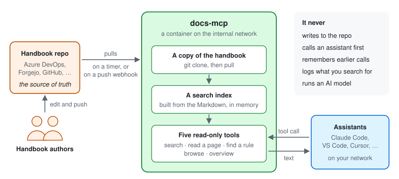
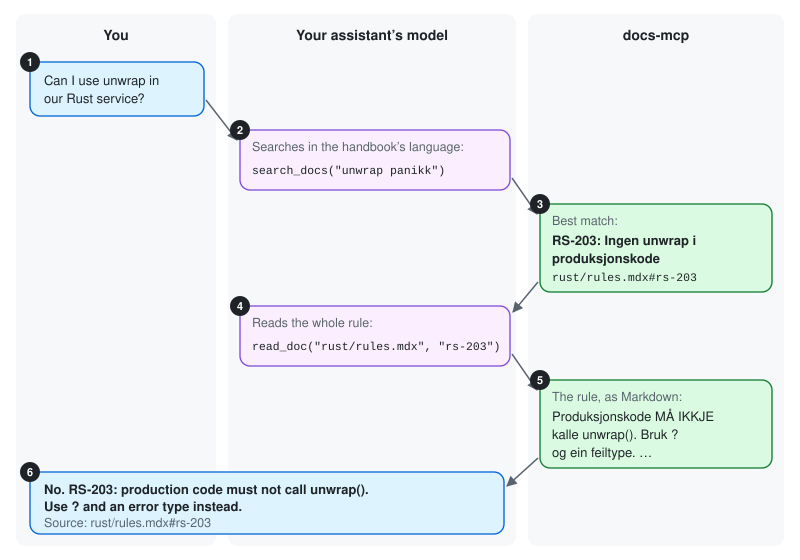

# What docs-mcp does

docs-mcp lets AI assistants search and read one handbook, so their answers rest
on your team's rules instead of guesses. This page explains what it does and
what it never does, without the technical details. New to MCP? Read
[What is MCP?](what-is-mcp.md) first.

## In one picture

- **The handbook repo is the source of truth.** Authors write Markdown pages and
  push them, as they do today. docs-mcp has no editor and no database of its own.
- **docs-mcp keeps a copy.** It pulls the repo, reads every page and builds a
  search index in memory.
- **Assistants ask, docs-mcp answers.** Your assistant connects to it over the
  internal network, like any other [remote MCP server](what-is-mcp.md#local-and-remote-servers),
  and calls its tools.

It can serve more than the handbook. A repo of pipeline templates, or the
template new Python projects start from, can be **sources** too, each with a
description that tells the model when to use it. Files that are not Markdown,
such as YAML or `pyproject.toml`, come back exactly as written.

It runs once, centrally. You do not install anything. You add its address to
your assistant, and either sign in with your work account or add a shared
token, depending on how it is set up.

## What your assistant can do with it

Five tools, and all of them only read:

| Tool | In plain words | For example |
|---|---|---|
| `search_docs` | Find the sections that match some keywords | *unwrap panikk* → rule RS-203 |
| `read_doc` | Read a page, or one section of it | the full text of RS-203 |
| `get_section` | Jump straight to a rule number or heading | `RS-203`, `PY-101` |
| `list_docs` | Browse the pages and their tags | every page tagged *backend* |
| `docs_overview` | Describe the handbook: folders, tags, which version | which tags exist to filter on |

Your assistant decides which tool to call and what to search for. docs-mcp
does not choose and does not interpret. It answers each call as well as it can.

## From question to answer

1. You ask, in any language.
2. Your assistant's model searches. The handbook is written in Nynorsk, and
   docs-mcp told the model so when it connected, so the model searches with
   Nynorsk keywords.
3. docs-mcp returns the best-matching sections, with a short snippet of each.
4. The model reads the section that looks right.
5. docs-mcp returns that section as plain text.
6. The model answers in your language and cites the rule, with a link to the
   handbook page.

The model makes every decision in that chain: whether to search at all, what to
search for, what to read, and when it knows enough.
[HOW-IT-WORKS.md](../HOW-IT-WORKS.md) shows the real messages for this exact
question.

## How it stays up to date

- **It checks the repo for changes regularly**, every one to five minutes
  depending on the setup. Or right away, if the repo sends a webhook on every
  push.
- **It builds the new version on the side** and switches over in one step.
  Every answer comes from one complete version of the handbook, never a mix.
- **If a pull fails, it keeps answering from the last good version**, and
  reports the error on its health page.
- **Two copies can be a minute apart.** When it runs as several copies, a push
  reaches them at slightly different times.

## What it deliberately does not do

| It does not | What that means for you |
|---|---|
| **Run an AI model** | It is a search engine with an MCP front door. Understanding your question and writing the answer happen in your assistant |
| **Change anything** | All five tools only read. Its git access is read-only. Nothing you or your assistant send can change the handbook or the server |
| **Remember you** | Every call stands alone: no sessions, no history |
| **Log what you search for** | Its logs record startup, syncs, errors and refused requests, never tool calls or their arguments |
| **Contact anything but the repo** | It talks to the git host and nothing else: no analytics, no outside services |
| **Start anything** | It never contacts your assistant first, never uses your model, never asks you questions |
| **Keep track of who you are** | With a shared token, it cannot tell users apart. With [Entra ID sign-in](sso-entra.md), it checks that Entra ID signed you in, and does not record or use who you are |
| **Reach your computer** | It is a remote server. It only sees the calls your assistant sends it |

## Who is responsible for what

| Who | Looks after |
|---|---|
| **docs-mcp maintainers** | The code, the [specification](../SPEC.md) and the tests: that it reads only the handbook, serves only text, and keeps its secrets |
| **Operators**, who run it | Where it runs, sign-in or the token, encryption in transit (TLS), who can reach it, and a read-only git token with no more reach than it needs |
| **Handbook owners** | What the handbook says, and who may change it: review before merge |
| **You** | Which servers your assistant connects to, and what you let it do with your other tools |

## Can I trust it?

The answers to the [six questions](what-is-mcp.md#before-you-trust-an-mcp-server)
for any MCP server:

1. **Where does it run?** Centrally, on the internal network. Not on your computer.
2. **What tools does it offer?** Five, all read-only. See [above](#what-your-assistant-can-do-with-it).
3. **Where does its text come from?** From the handbook repo only. Anyone who
   can change the handbook can change what your assistant reads.
4. **What does it keep?** Nothing about you or your calls.
5. **What does it hold?** A read-only token for the handbook repo, which it
   sends only to the repo's host. With a shared token, also that token. With
   Entra ID sign-in, nothing of yours: it checks the token Entra ID gave your
   assistant, and forgets it.
6. **Can you read the code?** Yes, this repository. There are two
   implementations, Rust and Python, and one shared test suite checks that both
   behave the same.

The one thing docs-mcp cannot protect you from is the content itself. It passes
the handbook's text to your model unchanged, because that is its job. If someone
got text into the handbook that tries to make your assistant do something
harmful, docs-mcp would serve it like any other page. Review on the handbook
repo, and your assistant's permission prompts, are what stop that. The
[threat model](threat-model.md) goes through this and every other risk we know
of, and what we have done about each.
