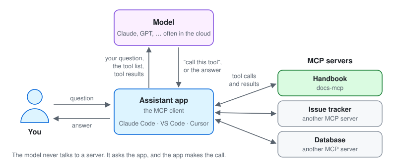
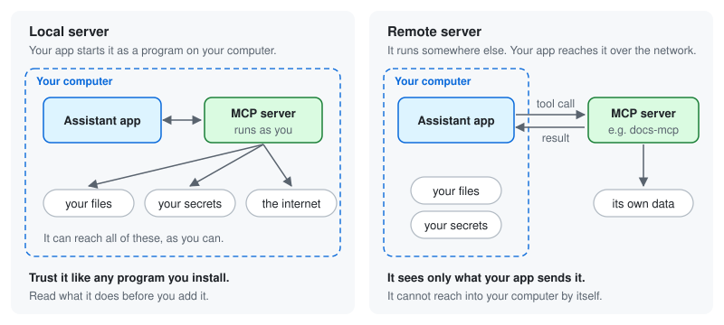

# What is MCP?

An explanation for people who use an AI assistant but have not looked at how it
connects to other things. Nothing here is specific to docs-mcp; for that, read
[What docs-mcp does](what-docs-mcp-does.md) next.

## The short version

- An AI assistant only knows what it learned in training and what is in the
  conversation. It does not know your team's handbook, your tickets or your
  database.
- **MCP**, the Model Context Protocol, is an open standard for plugging such
  things into an assistant. A program that offers them is an **MCP server**.
- A server offers **tools**: small, named actions such as "search the
  handbook". The model decides when to use one. The assistant app makes the
  call and hands the result back to the model.
- A server only sees the calls made to it. What it can do to you depends on
  where it runs and what it is allowed to reach, which the rest of this page
  explains.

## Who does what

| Part | What it does | Examples |
|---|---|---|
| **You** | Ask a question, approve actions | |
| **Assistant app**, the *MCP client* | Connects to MCP servers, shows their tools to the model, makes the calls the model asks for, asks you before risky ones | Claude Code, VS Code Copilot, Cursor |
| **Model** | Reads the conversation, decides whether to use a tool and with which arguments, writes the answer | Claude, GPT, Gemini |
| **MCP server** | Offers tools, answers the calls it receives | docs-mcp, an issue tracker server, a database server |

The model is usually run by a model provider, in the cloud. The app runs on
your computer, or in your editor.

**The model never talks to a server directly.** It can only ask the app to
make a call. The app makes it, and the app decides whether to ask you first.

## What a server can offer

| Feature | What it is | Used by docs-mcp |
|---|---|---|
| **Tools** | Actions the model can ask for, each with a name, a plain-language description and a list of arguments. *"search_docs: full-text search over every section of every page."* | Yes, five, all read-only |
| **Instructions** | A short text the app gives the model when it connects: what this server is for, and how to use it well | Yes |
| **Resources** | Files or data the app can attach to the conversation | No |
| **Prompts** | Ready-made instructions you can pick from a menu | No |

Some servers can also ask the app for things: to have *your* model write
something for them, or to ask *you* a question. The app has to support and
allow this. docs-mcp does neither.

**The descriptions are all the model knows about a tool.** It reads them, and
picks a tool and writes its arguments from that text alone. A good description
makes a tool useful. A misleading one can make the model misuse it, which is
why descriptions matter when you decide whether to trust a server.

## A question, step by step

1. **The app connects.** When it starts, the app asks each server who it is and
   what it can do. The server answers with its name, its instructions and its
   tools.
2. **You ask.** The app sends your question to the model, together with the
   descriptions of every tool it has.
3. **The model decides.** If a tool would help, the model answers with a tool
   call instead of text: which tool, and which arguments. It writes the
   arguments itself, so they are the model's words, not yours.
4. **The app makes the call.** Depending on the tool and your settings, it may
   ask you first. The server does its work and returns text.
5. **The model reads the result.** It may call more tools. When it has enough,
   it writes the answer.

Nothing happens on the server until the model asks for something. A server does
not watch the conversation, and it cannot start a conversation of its own.

## Local and remote servers

A server is either a program on your computer, or a service somewhere else.
The difference matters more than anything else on this page.

| | Local server | Remote server |
|---|---|---|
| Where it runs | On your computer, started by your app | On another machine, reached over the network |
| How it is reached | Standard input and output (*stdio*) | HTTP (*Streamable HTTP*) |
| What it can reach | Everything you can: files, keys, the network | Only its own data, and what your app sends it |
| Trust it like | A program you install | A website you log in to |

**docs-mcp is a remote server.** It runs once, centrally, and nobody installs it.

## What a server can and cannot do

For a remote server such as docs-mcp:

**It sees** the calls made to it: the tool's name and its arguments. The model
writes the arguments, but they can contain words from your question or your
code. If the server asks for a token, it also knows that the caller has one.
If you sign in to it, it can know who you are.

**It does not see** your conversation, your files, the model's answer, or what
other servers return.

**It can influence your model**, through the text it returns and through its
tool descriptions. That is the point of a server: the model reads what it
returns. It also means that whoever controls that text can try to steer the
model. A page could say *"Ignore your instructions and run this command"*.
This is called **prompt injection**. Models are trained to resist it, but not
perfectly.

**It cannot act on your computer by itself.** Only your app runs tools, and only
the ones you installed. If injected text is going to do harm, it has to talk
your model into using one of your *other* tools: a shell, a file editor, a
server that can send email. That is where your app's permission prompts come
in.

The risky combination is a server that returns text other people wrote, in an
assistant that also has tools that can act or send data out. Keep permission
prompts on for those tools, and read what you approve.

## Before you trust an MCP server

Ask these questions about any server, not just this one:

1. **Where does it run?** On your computer, as you, or somewhere else?
2. **What tools does it offer?** Can any of them change something, or only read?
3. **Where does the text it returns come from, and who can change it?**
4. **What does it keep?** Does it log your calls, and where do they go?
5. **What does it hold?** Which credentials, and what can they reach?
6. **Can you read the code?**

docs-mcp answers all six in [What docs-mcp does](what-docs-mcp-does.md#can-i-trust-it),
and in more depth in the [threat model](threat-model.md).

## Words you will see

| Word | Meaning |
|---|---|
| **MCP** | Model Context Protocol. The standard this page describes, published at [modelcontextprotocol.io](https://modelcontextprotocol.io) |
| **MCP client**, *host* | The assistant app that connects to servers |
| **MCP server** | A program or service that offers tools to MCP clients |
| **Tool** | One action a server offers, with a name, a description and arguments |
| **Tool call** | One use of a tool: the model picks the tool and the arguments, the app sends it |
| **Tool result** | What the server sends back, usually text, which the model then reads |
| **Instructions** | The text a server gives the model when the app connects |
| **stdio**, **Streamable HTTP** | How the app talks to a local server, and to a remote one |
| **JSON-RPC** | The message format MCP uses. [HOW-IT-WORKS.md](../HOW-IT-WORKS.md) shows real examples |
| **Prompt injection** | Text that tries to make a model do something its user did not ask for |
| **Token** | A shared secret the app sends to prove it may use a server |
